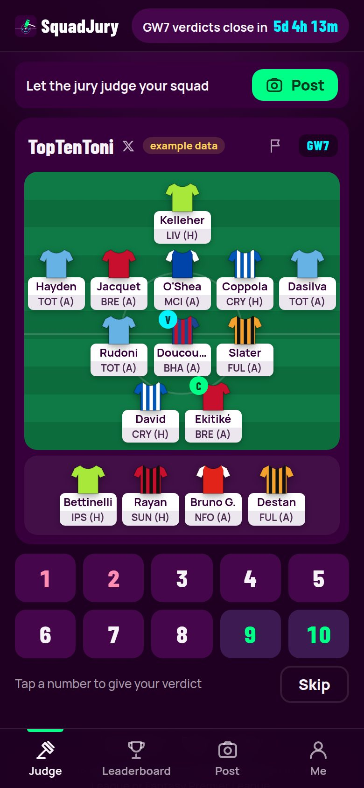
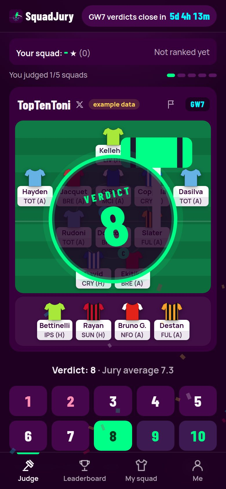
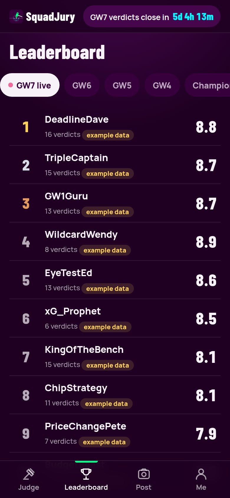
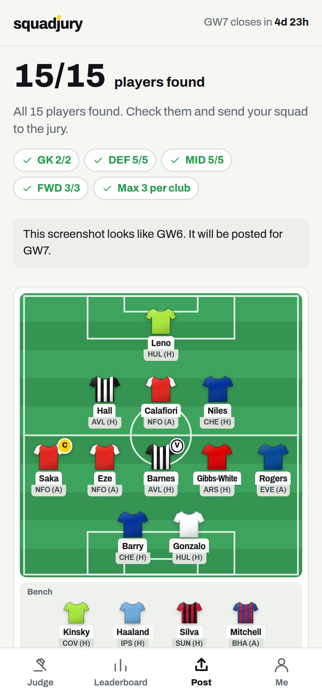
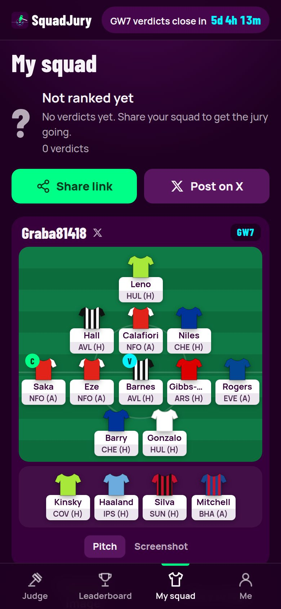
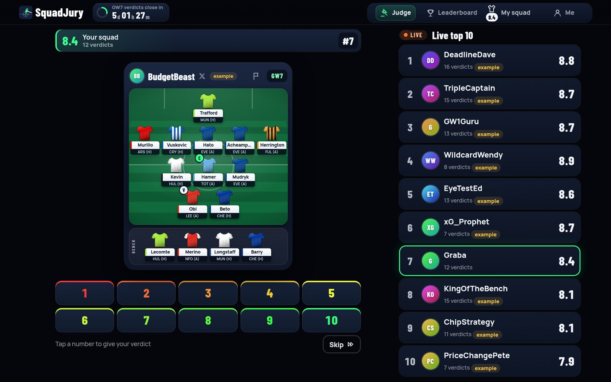
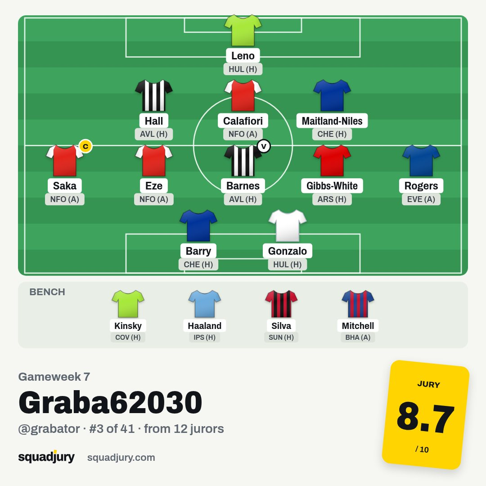
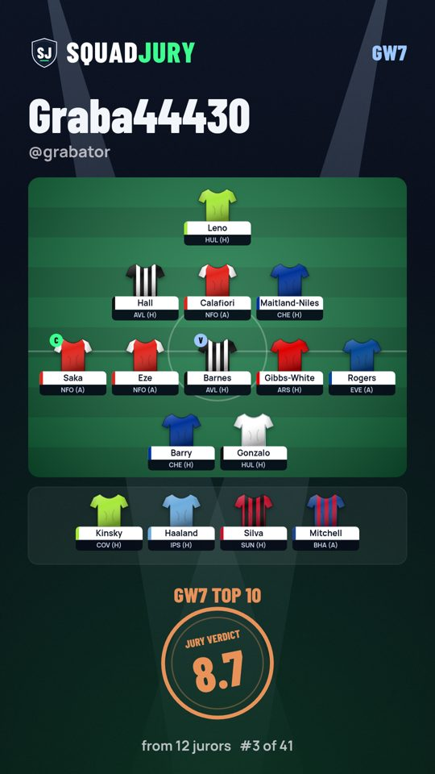

<p align="center"></p>

<p align="center"><strong>Post your squad. The jury decides.</strong></p>

SquadJury is a web app for Fantasy Premier League players. You upload a screenshot of your squad from the official FPL app, SquadJury reads all 15 players for you, and the community judges it from 1 to 10. Verdicts stay open until the FPL deadline, the best rated squads top the leaderboard, and the top 10 of every gameweek is kept for good.

Built mobile first, with no framework and no build step, on Cloudflare Workers.

<p align="center">
  
  
  
</p>
<p align="center">
  
  
</p>

## Features

- **Sign in with Google**, one tap, then pick a nickname (and optionally add your X username).
- **Squad reader:** upload a Pick Team screenshot and the browser reads the 15 players, their positions, the bench, the captain and the vice captain. Nothing to type. Anything it misses can be fixed with a player search.
- **Judge:** one squad at a time on a bright pitch that fills the screen. Tap 1 to 10, a yellow card shows your verdict and the next squad slides in. Swipe left (or press S) to skip; on a keyboard, keys 1 to 9 and 0 give a verdict.
- **Leaderboard:** one clean list: live standings for the open gameweek, the final top 10 of any past gameweek (picked from a list) and a Season table. Your row is marked and stays pinned while you scroll.
- **Fair ranking:** a squad needs 5 verdicts, and its owner must judge 5 other squads, to be ranked. The rank uses a Bayesian average so a handful of 10s cannot beat a squad with many strong verdicts.
- **My squad:** live verdict, rank, "better than X% of squads", how the jury voted, and sharing.
- **Share:** each squad has its own link with a link preview card (1200x630), a one tap "Post on X", and images to post: a square 1080x1080 for X and 1080x1920 for stories.
- **Duels:** a Duel mode in Judge shows two squads, the juror taps the better one. Every squad gets a duel rating (Elo, start 1500, K 24) and a win/loss record, with a Duels view on the leaderboard and the last 10 duels on the squad page. Too quick picks (under 1 second), always the same side and more than 200 duels per gameweek do not count.
- **League head to head:** leagues with 4+ members get round robin fixtures every gameweek (odd numbers play "Average"). Each match has a Jury result (duel votes between the two squads, before the deadline) and a Points result (real FPL points), with a Jury table and a Points table and a share image for the winner.
- **Plan A vs Plan B:** a second version of your squad that jurors compare in Duel mode. Pick one at least 30 minutes before the deadline, or the plan with more votes is used.
- **Scout points:** the verdict question is "How good is this squad this GW?" (1 flop, 10 haul). After the gameweek every squad gets a true score from 1 to 10 by real points; a verdict on it earns 10, 1 away 8, 2 away 6, 3 away 3, a right duel pick 5. Jurors with 10+ verdicts get a scout score per gameweek and for the season (Scouts on the leaderboard, in leagues and on the profile).
- **Real points:** after the gameweek the real FPL points of every squad are added (starting XI, captain doubled, automatic substitutions), with a Jury / Points switch on the leaderboard and a result image to share. With an FPL team ID in the profile the exact FPL score is used.
- **Me:** your numbers, your verdicts grouped by gameweek and shown a page at a time, your squads, and settings. Light and dark theme follow the phone.
- **Deadlines from FPL:** voting closes at the official deadline, the gameweek locks and its results are frozen automatically.
- **Fair play:** one squad per account per gameweek, one verdict per squad, no judging your own squad, rate limits, reduced weight for accounts that only give 1 or 10, and reports that hide a squad after 3 reports until an admin reviews it.
- **Installable** as an app (PWA), accessible (keyboard, screen readers, reduced motion) and fast on phones.

<p align="center"></p>
<p align="center"> </p>

## How it works

| Part | Technology |
| :-- | :-- |
| App | Vanilla JavaScript (ES modules), no framework, no build step |
| Hosting and API | One Cloudflare Worker with static assets |
| Database | Cloudflare D1 (SQLite) |
| Screenshots and share cards | Cloudflare R2 |
| Deadlines and FPL data | Cloudflare Cron Triggers and the public FPL API |
| Squad reader | Tesseract.js running in the browser, self hosted |
| Sign in | Google Identity Services, with our own HttpOnly session cookie |

The squad reader finds the white name cards on the screenshot, reads each card on its own, then double checks the whole image at several contrast levels. The words it reads are matched against all FPL players (with fuzzy matching for misreads), players with the same surname are told apart by the fixture under their name, and the squad is checked against FPL rules.

## Run it locally

Requirements: Node.js 20 or newer.

```bash
npm install
npm run db:migrate      # create the local database
npm run seed            # optional: example jurors and squads, marked "example data"
npm run dev             # http://localhost:8787
```

Local development uses a bundled snapshot of FPL 2026/27 data and a developer sign in (no Google account needed). Add `?now=2026-10-17T12:00:00Z` to the URL to simulate a different time, for example to test a deadline.

## Tests

```bash
npm test                # unit tests: ranking, squad rules, name matching, X post length
npm run test:ocr        # reads two real Pick Team screenshots end to end (15 of 15)
npm run test:api        # API tests on a throwaway database
node tests/e2e/run.mjs      # full flow in a real browser (needs npm run dev)
node tests/e2e/audit.mjs    # accessibility and layout on every page at 360 to 1280 px
node tests/e2e/perf.mjs     # load time on a simulated phone over 4G
node tests/e2e/fit.mjs      # Judge and Post fit one phone screen on 5 sizes, 360x640 to 430x932
node tests/e2e/qa.mjs       # walks through every screen like a user and lists anything broken
```

The browser tests look for Chromium in the usual places; set `CHROME_PATH` to point at a different browser.

## Deploy

1. Create the database and the bucket:
   ```bash
   npx wrangler d1 create squadjury
   npx wrangler r2 bucket create squadjury-images
   ```
   Put the `database_id` printed by the first command into `wrangler.jsonc`.
2. In Google Cloud, create an OAuth client id of type **Web application** with `https://squadjury.com` as an authorised JavaScript origin, and put the client id in `GOOGLE_CLIENT_ID` in `wrangler.jsonc`.
3. Store the Google email(s) that may open `/admin` as a secret (comma separated), so they never end up in the repo:
   ```bash
   npx wrangler secret put ADMIN_EMAILS
   npx wrangler secret put ADMIN_TOKEN
   ```
   `ADMIN_TOKEN` is any long random text; `npm run points` uses it when FPL blocks the Worker.
4. Apply the schema and deploy:
   ```bash
   npx wrangler d1 migrations apply squadjury --remote
   npm run deploy
   ```
5. In the Cloudflare dashboard, add `squadjury.com` as a custom domain of the `squadjury` Worker.

## Seasons

Gameweek numbers repeat every season, so the database stores a gameweek as a season key: 2026/27 GW7 is `202607`, and every table with a gameweek also has a `season` label (`2026-27`). The season comes from the FPL data (the year of the first deadline), the API and the app keep using plain gameweek numbers, and the Season tab only counts the current season. When FPL publishes the next season in summer, nothing needs to change.

## Real points

Every hour a cron job looks for finished gameweeks (FPL `finished` and `data_checked`), reads the live points from FPL and scores each squad: the starting XI, the captain doubled (the vice when the captain did not play) and automatic substitutions from the bench, keeping a valid formation. Squads whose owner added an FPL team ID get their exact FPL score instead (40 per run). If FPL cannot be reached, the job tries again every hour for 48 hours.

FPL sometimes blocks requests from Cloudflare. Then run the job from your own computer, which sends the live points to the Worker:

```bash
npx wrangler secret put ADMIN_TOKEN
```

PowerShell:

```powershell
$env:BASE="https://squadjury.com"; $env:ADMIN_TOKEN="the same token"; npm run points -- --gw 7
```

`/admin` also shows the state of each finished gameweek and has a **Fetch points** button.

## Backups

- **Weekly backup:** every Monday at 04:17 UTC a cron job writes all tables (without sessions and caches) as gzipped JSON to R2, `squadjury-images/backups/YYYY-MM-DD.json.gz`. The last 8 are kept. `/admin` shows the latest backups and has a **Backup now** button.
- **D1 Time Travel** (built in, last 30 days): the quickest fix for a recent mistake, for example a wrong delete. It restores the whole database to a minute in the past:
  ```bash
  npx wrangler d1 time-travel info squadjury
  npx wrangler d1 time-travel restore squadjury --timestamp=2026-10-19T10:00:00Z
  ```
- **Use a weekly backup** when the problem is older than 30 days, or to copy data somewhere else. Check it locally first:
  ```bash
  npx wrangler r2 object get squadjury-images/backups/2026-10-19.json.gz --file backup.json.gz --remote
  node scripts/restore-backup.mjs backup.json.gz
  ```
  Restoring to production replaces the live data, so it needs an explicit flag (PowerShell: `$env:RESTORE_REMOTE=1`, cmd: `set RESTORE_REMOTE=1`), then `node scripts/restore-backup.mjs backup.json.gz --remote`.

## Project structure

```
public/            the app (HTML, CSS, JS, fonts, logo, icons)
  js/views/        screens: judge, leaderboard, post, squad, me, team, pages, admin
  js/ocr/          the squad reader (shared by the browser and the tests)
src/               the Worker: API, sessions, FPL data, gameweek locking
migrations/        D1 schema
scripts/           logo, icons, share card, FPL snapshot, example data, vendor files
tests/             unit, OCR, API and browser tests with real screenshot fixtures
```

The logo is generated by `scripts/logo.py`; five variants live in `public/img/logo/variants`. To switch, change `CHOSEN` in that script and run `npm run logo`.

## Credits

- Font: Archivo, under the SIL Open Font License.
- Squad reader: Tesseract.js (Apache 2.0).
- FPL snapshot for local development built from the public FPL data collected in [vaastav/Fantasy-Premier-League](https://github.com/vaastav/Fantasy-Premier-League).

SquadJury is a fan project and is not affiliated with the Premier League or Fantasy Premier League. Shirts on the pitch are generic shapes in club colours; no club badges or official kits are used.

## Author

Ahmed Grabus ([grabator](https://github.com/grabator))
